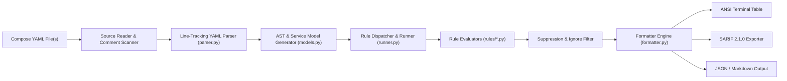

# 🏗️ Architecture & Internal Design

This document details the internal design and pipeline architecture of **Docker Compose Validator**.

---

## 🔍 Validation Pipeline



---

## 📍 Line-Number Tracking Mechanism

Standard Python YAML loaders (`yaml.safe_load`) discard YAML node positional metadata, making it impossible to report the exact line number of violations.

**Docker Compose Validator** implements a custom `SafeLineLoader` derived from PyYAML's `SafeLoader`:
1. Every dictionary mapping and scalar value is subclassed into a `LineTrackedDict` or `LineTrackedScalar`.
2. When the YAML parser encounters a node event, it captures the start line and column from the parser stream mark (`node.start_mark.line + 1`).
3. Rule evaluations reference the exact node mark, allowing IDEs, GitHub Annotations, and terminal outputs to highlight the exact offending line.

---

## 📦 Package Module Breakdown

| Module | Responsibility |
|---|---|
| `cli.py` | Command-line argument parsing, environment variable detection, and return code management. |
| `parser.py` | Custom PyYAML `SafeLineLoader` implementation with line-offset capture and inline comment extraction. |
| `models.py` | Strongly-typed dataclasses representing `ComposeFile`, `ServiceDefinition`, `Violation`, and `Severity`. |
| `runner.py` | Orchestrates rule execution across discovered services and filters out disabled rules. |
| `rules/` | Modular rule evaluators categorized under `security.py`, `reliability.py`, `syntax.py`, and `best_practices.py`. |
| `formatter.py` | Formats validation findings into ANSI color tables, GitHub SARIF 2.1.0, JSON, Markdown, and Unix short-format. |

---

## 🛡️ Rule Evaluation & AST Walking

Rules implement a uniform base interface:

```python
class BaseRule(ABC):
    id: str
    name: str
    severity: Severity
    category: Category

    @abstractmethod
    def evaluate(self, compose_file: ComposeFile) -> List[Violation]:
        """Inspects compose AST and yields rule violations with exact line metadata."""
        pass
```

Each rule performs isolated evaluations without side effects, ensuring deterministic, parallelizable performance across multiple configuration files.
