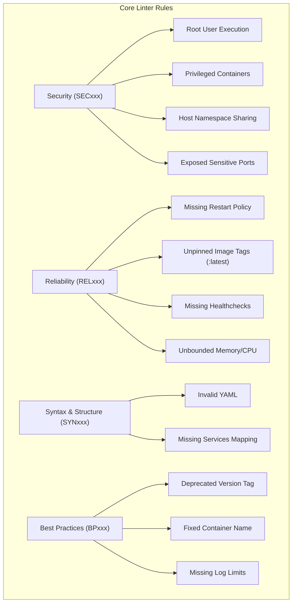

# 🐳 Docker Compose Validator Documentation

Welcome to the comprehensive documentation for **Docker Compose Validator**, the production-grade linter, security auditor, and best-practices analyzer for container deployments.

---

## 📚 Documentation Index

| Guide | Description |
|---|---|
| [**Architecture**](Architecture.md) | Deep dive into YAML AST line-number mapping, the rule registry, validation engine, and SARIF exporter. |
| [**Quick Start**](Quick-Start.md) | Fast setup, essential CLI invocations, recursive scanning, and CI/CD pipeline integration. |
| [**Troubleshooting**](Troubleshooting.md) | Handling inline rule suppressions, unparseable Compose syntaxes, exit code troubleshooting, and FAQ. |
| [**Performance Guide**](PERFORMANCE_GUIDE.md) | Parser execution benchmarks, memory footprints, and large-scale repository scanning. |

---

## 🛡️ Rule Categories

- **Security (`SEC`)**: Hardens containers against privilege escalation, host compromises, and unauthorized network exposure.
- **Reliability (`REL`)**: Prevents production outages caused by container crashes, unpinned updates, and out-of-memory cascades.
- **Syntax (`SYN`)**: Ensures compliant Compose file structure before calling docker-compose or container runtimes.
- **Best Practices (`BP`)**: Keeps compose definitions aligned with the modern Compose Specification.
